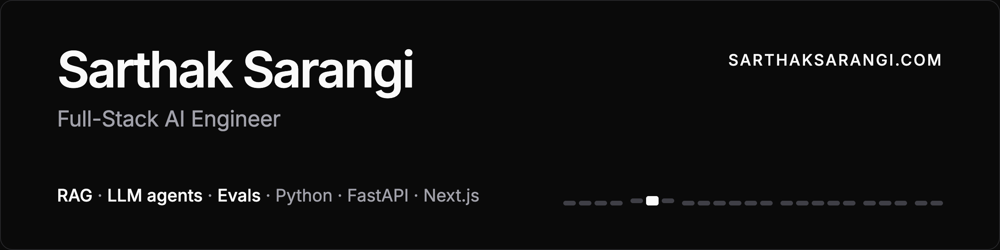

  

  
  
  
  
  

## 👋 About me

- 🛠️ Software Engineer at **Exotel**, building LLM-powered automation with FastAPI and Pydantic
- 🔍 I build **RAG systems, LLM agents and the products around them**, from the Python backend to the Next.js frontend
- ✍️ Writing **[AI Engineering, Explained](https://sarthaksarangi.com/blog/ai-engineering-explained)**, a 23-part series on building with LLMs
- 💬 Ask me about RAG, agents, FastAPI or Next.js

## ✍️ Featured writing

How LLMs work, prompting and tool calling, RAG, agents and MCP, evals, security, cost and system design, each explained from first principles with code and interview questions.

## 🚀 Projects

<table>
  <tr>
    <td width="50%" valign="top">
      <h3><a href="https://github.com/sarthaksarangi/docsage">DocSage</a></h3>
        
      RAG assistant for technical PDFs: chunking, embeddings, semantic search with metadata filters, and answers with source citations.  
      <code>Python</code> <code>LangChain</code> <code>Gemini</code> <code>pgvector</code> <code>Streamlit</code>
    </td>
    <td width="50%" valign="top">
      <h3><a href="https://github.com/sarthaksarangi/tickr-flow">TickrFlow</a> · <a href="https://tickrflow.sarthaksarangi.com/">live</a></h3>
        
      Stock market app with a daily LLM pipeline that emails personalized market summaries.  
      <code>Next.js</code> <code>TypeScript</code> <code>Gemini</code> <code>Inngest</code>
    </td>
  </tr>
</table>

**Also:** [**Pay-X**](https://github.com/sarthaksarangi/pay-x) ([live](https://user-payx.sarthaksarangi.com/)), a payments platform in a Turborepo monorepo (Next.js, Express, Prisma, PostgreSQL) · [**Blogify**](https://github.com/sarthaksarangi/medium-blog-fe) ([live](https://blogify.sarthaksarangi.com)), a blogging platform on Cloudflare Workers (React, TypeScript, Hono)

## 🛠️ Tech stack

**AI and backend** (plus LangChain, LangGraph, MCP, RAG, embeddings, prompt engineering and tool calling)

  

**Web**

  

**Deploy and tools**

  

---

  

